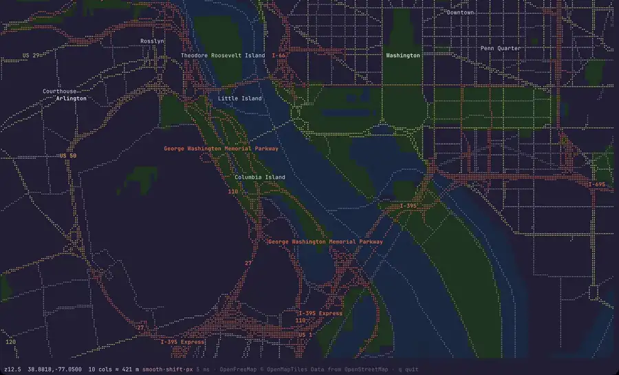

# mapterm

[](https://github.com/tlpinney/mapterm/actions/workflows/ci.yml)
[](https://crates.io/crates/mapterm)
[](https://docs.rs/mapterm)
[](Cargo.toml)
[](LICENSE)
[](https://mapterm.com)

A map in your terminal, with the pan, zoom and styling of a web map, that also works
over SSH.

Get it with `cargo install mapterm` ([other ways](#install)).



<details>
<summary>Watch the full 45s video</summary>

https://github.com/user-attachments/assets/8bf59b7f-3156-4820-aeeb-2b138fc5bc2b

</details>

- **Any vector tiles:** OpenFreeMap out of the box (no key), PMTiles files locally or over
  HTTP, XYZ URLs and TileJSON, drawn in braille with cell-color fills and labels that
  don't collide.
- **MapLibre styles:** liberty, positron and the other OpenFreeMap styles, or your own,
  with expressions, filters, fonts and point icons.
- **Imagery:** satellite and aerial layers (OSM, Esri, USGS, NASA GIBS, and keyed
  providers such as Vantor, Planet and Mapbox) as real images in kitty-graphics terminals, or as
  cell colors anywhere else.
- **Your data:** GeoJSON, CSV, GPX, KML and FlatGeobuf, from a file or a URL, drawn over
  the map, with clustering for large point sets.
- **Search and inspect:** find a place and fly there; point at anything to see its
  features and properties, and copy them as JSON.
- **Scriptable:** `--snapshot` prints a frame as text, ANSI or HTML, and `--pick` prints
  the features at a spot as JSON.

The same code is a library: a [ratatui](https://ratatui.rs) widget with a MapLibre GL
style API (sources, style layers, expressions, events and feature state, feature
queries) that you can drop into your own terminal apps.

Docs, a tour and the full guide: [mapterm.com](https://mapterm.com)

## Install

With Cargo (Rust 1.89 or newer, from [rustup.rs](https://rustup.rs)):

```sh
cargo install mapterm
```

On Linux (x86-64) you can also download a signed binary from
[Releases](https://github.com/tlpinney/mapterm/releases); the release notes show how to
verify it. To use the library in your own app: `cargo add mapterm`.

## Try it

```sh
mapterm                                                # OpenFreeMap planet, no key needed
mapterm --at 38.8895,-77.0353 -z 13                    # start somewhere (lat,lon) at zoom 13
mapterm https://build.protomaps.com/20261031.pmtiles   # Protomaps planet over HTTP range requests
mapterm dc.pmtiles --at 38.8899,-77.0091 -z 13          # a local PMTiles file, offline
mapterm --style liberty                                # any MapLibre style: liberty, positron,
mapterm --style ./my-style.json                        #   bright, dark, fiord, a URL or a file
mapterm --style mapbox://styles/mapbox/streets-v12 --mapbox-token-cmd 'pass show mapbox-token'  # Mapbox
mapterm --snapshot 120x40 --at 38.8895,-77.0353         # print one frame as text and exit
mapterm --snapshot 120x40 --format html > map.html       #   ... or as colored ANSI text or HTML
```

Without `--style`, mapterm draws the source with its own terminal style (OpenMapTiles
or Protomaps schema, detected from the tiles; `--light` or `t` for the light theme).
MapLibre styles draw what a terminal can show: colors, fills, lines, labels (bold and
italic fonts), filters and zoom ranges, and point icons as one-cell symbols (✚ hospital,
✈ airport, ⋔ restaurant, ◡ café, Ⓑ bus stop, ...). Wide lines draw two or three
braille dots thick and dashed lines dotted; imagery opacity blends with the
background in cell-color mode; blur, patterns and 3D are skipped. The
built-in style shows points of interest from zoom 15, more as you zoom in.

## Controls

They follow the MapLibre GL / Mapbox GL defaults:

- **Scroll / two-finger swipe up and down:** zoom toward the cursor
- **Drag:** pan, and a fling keeps gliding (inertia)
- **Double-click:** zoom in; **shift+double-click:** zoom out
- **Shift+drag:** box zoom
- **Arrows** (or `hjkl`) pan, **`+`/`-`** zoom to the next level, both eased
- **`/`** searches for a place: type, press Enter, and the map flies there
  (MapLibre's flyTo curve). Several matches open a list (↑/↓, Enter or click);
  Esc clears the marker. Searches go to [Photon](https://photon.komoot.io), an
  OpenStreetMap geocoder, only when you press Enter; `MAPTERM_GEOCODER=nominatim`
  or the URL of your own Photon or Nominatim server switches.
- **`m`** switches the map style: the built-in one, then OpenFreeMap's liberty,
  positron, bright, dark and fiord (a `--style` you started with comes first).
  Imagery stays underneath and your GeoJSON layers on top.
- **`c`** copies the coordinates under the pointer (or the map center) as
  `lat, lon` to the clipboard (OSC 52).
- Terminal extras: sideways swipes pan; `i` inspect, `v` vector overlay, `n` labels, `t` light/dark theme (built-in style), `q` quit

## GeoJSON layers

`--geojson FILE|URL` draws your data over the map, as many layers as you like:

```sh
mapterm --geojson sites.geojson --geojson https://example.com/routes.geojson
mapterm --geojson stores.csv --geojson run.gpx --geojson places.kml
```

Besides GeoJSON it reads CSV/TSV with latitude/longitude columns (`lat`,
`latitude`, `lon`, `lng`, `longitude`, any case) or a WKT geometry column, GPX
(waypoints, tracks, routes), KML (placemarks with their names, descriptions
and extended data; unzip KMZ first) and FlatGeobuf (lon/lat). The format comes
from the extension, else the content. Files and URLs up to 512 MB.

- Points, lines and polygons (including Multi* and GeometryCollection), each
  layer in its own color with a legend in the status bar; polygon interiors are
  tinted (left clear over a raster layer).
- Features with a `name` (or `title`/`label`) property are labeled.
- Without `--at`, the map starts zoomed to fit all layers.
- Inspect mode (`i`) lists your features first, with all their properties, and
  `--snapshot ... --pick COL,ROW` prints them as JSON lines.
- Big files stay fast: features are spatially indexed, and a layer with more
  than 1,000 points clusters them (`◉ 152`) until you zoom in, as MapLibre's
  `cluster: true` does.

## Raster layers

`--raster` puts an image tile layer under the vector map, by provider name or URL:

```sh
mapterm --raster esri --at 38.8895,-77.0353 -z 15        # satellite
mapterm --raster 'https://tile.openstreetmap.org/{z}/{x}/{y}.png'
mapterm --raster gibs --date 2026-10-30 -z 6                # NASA daily imagery
mapterm --raster mall.pmtiles                              # your own imagery, offline
mapterm --raster-list                                      # providers and the keys they need
```

`--raster` also takes a PMTiles archive of PNG, JPEG or WebP tiles, as a local
file or an `https://` URL read with range requests: a single file of your own
imagery that works offline.

| Name | Imagery | Key |
|---|---|---|
| `osm` | OpenStreetMap standard map (light use only) | none |
| `esri` | Esri World Imagery, global satellite | none |
| `usgs` | USGS National Map imagery, US only, public domain | none |
| `eox` | Sentinel-2 cloudless 2024, global, ~10 m (CC BY-NC-SA) | none |
| `gibs` | NASA GIBS daily satellite imagery, ~250 m (`--date`, default yesterday) | none |
| `esri-light`, `esri-dark` | Esri Gray Canvas, quiet backgrounds for overlays | none |
| `vantor` | Vantor (Maxar) Vivid basemap | `VANTOR_API_KEY` |
| `planet` | Planet basemaps (your subscription's mosaics) | `PL_API_KEY` + a mosaic |
| `mapbox` | Mapbox Satellite, Retina tiles | `MAPBOX_ACCESS_TOKEN` |
| `maptiler` | MapTiler Satellite | `MAPTILER_KEY` |
| `google`, `google-roadmap`, `google-terrain` | Google Maps satellite, road map, terrain (Map Tiles API, billed per tile) | `GOOGLE_MAP_TILES_KEY` |

API keys never go on the command line: they come from the provider's
environment variable or from a command that prints the key, such as your password
manager's CLI:

```sh
mapterm --raster vantor --raster-key-cmd 'security find-generic-password -s vantor -w'  # macOS Keychain
mapterm --raster vantor --raster-key-cmd 'op read op://Private/Vantor/credential'      # 1Password
mapterm --raster vantor --raster-key-cmd 'secret-tool lookup service vantor'           # Linux keyring
```

Keys are only added to requests (Vantor's as the `maxar-api-key` header) and are
blanked out of errors. Google's tiles need a session, which mapterm asks for at start;
the status bar credits "Google Maps" and Google's imagery or map data credits for the
view (asked again when it settles somewhere new). Google tiles are kept on disk only as
long as each tile's `Cache-Control` header allows (a day, as of 2026), then checked with
its `ETag` instead of downloaded again, as Google's terms ask; `--raster-no-cache` turns
that off. Mapbox's tiles (`--raster mapbox`, and the vector tiles of `mapbox://` styles)
are cached the same way (12 hours, as of 2026); one token, from `--mapbox-token-cmd` or
`MAPBOX_ACCESS_TOKEN`, serves both. While the camera moves, paid imagery loads for where it
will stop, not for the views on the way, and `--raster-limit N|off` caps imagery requests
a minute (300 by default for keyed providers). Keyed providers don't cache tiles on disk unless you pass
`--raster-cache`, since commercial licenses often limit storing them. For any
other service, use its URL with `{key}` where the key goes (filled from
`MAPTERM_RASTER_KEY` or `--raster-key-cmd`), or for header-based keys
`--raster-header 'Name: {key}'` (e.g. `'Authorization: Bearer {key}'`). Write `{key}`
rather than the key itself: anything on the command line shows up in `ps` and in your
shell history.

Planet serves each customer's named mosaics: list the ones your key can use
with `mapterm --raster-list-mosaics`, then pick one with
`--raster planet --raster-param mosaic=NAME` (or `PLANET_MOSAIC`). Planet only
accepts the key in the tile URL; mapterm still never prints it.
`--raster-param NAME=VALUE` fills any other `{NAME}` in a custom URL; for GIBS,
`--raster-param layer=VIIRS_SNPP_CorrectedReflectance_TrueColor` picks another
layer (JPEG layers at 250 m).

- URLs use `{z}`, `{x}` and `{y}` in any order; for TMS services (rows counted
  from the bottom) use `{-y}` or add `--tms`.
- The status bar credits the imagery: Esri, USGS, OpenStreetMap and EOX are
  known; give anything else with `--raster-attribution TEXT`.
- On terminals with the kitty graphics protocol (Ghostty, kitty, WezTerm, and
  through herdr) tiles are real images underneath the text, so vector labels,
  lines, markers and inspect draw on top. Each tile is sent once; panning and
  zooming only move it. Elsewhere the layer becomes cell background colors.
  `MAPTERM_GRAPHICS=kitty` or `cells` overrides the guess.
- mapterm keeps at most 48 MiB of decoded images in the terminal (herdr allows
  64 MiB per pane), freeing tiles that are off screen first, so the terminal never
  drops one that is showing. `MAPTERM_KITTY_BUDGET_MB` changes it.
- **`v`** cycles the vector overlay: lines and labels, labels only, off. Area
  fills are always off over a raster layer.
- Tiles are cached on disk for 30 days and fetched at most two at a time.
  Respect each tile server's usage policy: OpenStreetMap's own tile servers
  allow only light use, with attribution.

## Inspect

Press **`i`** to switch to inspect mode, and `i` (or `Esc`) again to leave it.

- **Hover** shows the top feature under the pointer in the status bar.
- **Click** lists every feature at that spot, drawn or not (roads, street names,
  buildings, parks, landcover, points of interest...), most specific first,
  and highlights the selected one on the map.
- The panel shows the style layer that draws the feature (or that none does),
  its source layer, geometry type, center, length or area, vertex count, source
  tile, and all its properties.
- **Click an entry** or press **Tab / Shift+Tab** to switch between them;
  **`y`** copies the selected feature as JSON to the clipboard (OSC 52).

For scripts, `--pick` prints the same information as JSON lines:

```sh
mapterm --at 38.8895,-77.0353 -z 16 --snapshot 100x40 --pick 50,20
```

## What it reads

- **PMTiles v3**, from a local file or over HTTP range requests (own reader)
- **XYZ** URL templates (`…/{z}/{x}/{y}.pbf`) and **TileJSON** endpoints
- Vector tiles in the **OpenMapTiles** schema (OpenFreeMap, MapTiler) or the
  **Protomaps** basemap schema, in dark and light styles

Every download has a 30 s timeout and an 8 MB cap, decompression is capped at
32 MB, and HTTP tiles are cached on disk for 30 days (`~/.cache/mapterm`).

## Rendering

Roads, rivers and boundaries are braille lines (2x4 dots per character); water,
parks and buildings fill the cell background; labels avoid each other. While
sharper tiles load, lower-zoom tiles stand in for them.

## Use it in your own app

mapterm is also a library that works like MapLibre GL: a `Map` holds named
sources and an ordered list of style layers that say how to draw them.

```rust
let mut map = Map::from_style("liberty").await?;          // any MapLibre style
map.add_source("sites", MapSource::geojson(&sites)?)?;
map.add_layer(StyleLayer::fill("sites", "sites").color("#204060"))?;
map.add_layer(StyleLayer::symbol("pins", "sites")
    .filter(json!(["==", ["geometry-type"], "Point"]))
    .glyph("◆").text(json!(["get", "name"])).color("cyan"))?;

map.load_tiles(&ctl.cam, area).await?;
frame.render_widget(map.view(&ctl.cam), area);
let under = map.query_rendered_features(&ctl.cam, area, dot, Some(&["pins"]));
```

- Styles: `Map::from_style` takes an OpenFreeMap name (`liberty`, `positron`,
  `bright`, `dark`, `fiord`), a style URL or file, a Mapbox `mapbox://styles/...` URL
  (after `mapbox::set_access_token`), or `mapterm-dark` /
  `mapterm-light`, built-in styles tuned for terminal cells. Style layers can
  also be built in Rust with `StyleLayer`.
- Change the map with `set_data`, `set_paint`, `set_layout`, `set_filter`,
  `set_visibility` and `move_layer`. Filters and paint values are MapLibre
  expressions (`get`, `match`, `case`, `interpolate`, `step`, ... and the legacy
  filter syntax).
- A terminal cell can't show line widths, blur or fonts, so only colors,
  opacity (blended with the background), filters, zoom ranges, `text-field`,
  bold and italic fonts, `text-anchor` and `symbol-sort-key` are used. The
  `mapterm:glyph` layout property sets the character drawn at points.
- GeoJSON sources are spatially indexed, and `with_cluster` (or `cluster: true`
  in a style) clusters points; clusters carry `point_count` and
  `point_count_abbreviated`, and `cluster_expansion_zoom` says where they split.
- `events::Events` turns the pointer and clicks into MapLibre-style layer events
  (`Click`, `Enter`, `Leave` for the layers you name) and can set a `hover` feature
  state, so a layer styled with `["feature-state", "hover"]` lights up under the
  pointer. `set_feature_state` works for any feature with an id (GeoJSON `id`,
  vector tile ids, or a source's `promoteId` property).
- Anything else is a `CustomLayer`: `draw` (lines, fills, markers and labels
  through a `DrawContext`) and `pick`. Markers and labels from every layer are
  placed together, so they never overlap.
- `Controller` gives MapLibre-style mouse and keyboard handling and camera
  moves (`fly_to`, `ease_to`, `fit_bounds`), and `take_click` reports clicks for
  your own popups and panels. `geocode::Geocoder` searches places.

[`examples/hello_map.rs`](examples/hello_map.rs) builds a basemap from a few
style layers and adds a pin in about 50 lines, and
[`examples/style.rs`](examples/style.rs) shows any style
(`cargo run --release --example style -- dark`). `src/bin/mapterm.rs` is the
full viewer built on the same `Map` (background tile loading with
`tile_requests` / `insert_loaded`, kitty images with `kitty_commands`, and
`query_features` for inspect).

## Experimental: smooth scrolling

Terminals move content a whole character at a time. As an experiment, mapterm
can move the map by single pixels on terminals that support an experimental
smooth-scroll protocol. Today that is only
[Ghostty Smooth](https://github.com/tlpinney/ghostty/tree/smooth), a personal
fork of Ghostty (see its
[`SMOOTH.md`](https://github.com/tlpinney/ghostty/blob/smooth/SMOOTH.md)), and
the [herdr fork](https://github.com/tlpinney/herdr/tree/tlpinney) relays it
from herdr panes. Both are experimental and may change.

It is off unless you turn it on with an environment variable:

- `MAPTERM_SMOOTH=shift`: dragging follows the pointer pixel by pixel;
  scrolling still zooms.
- `MAPTERM_SMOOTH=1`: two-finger up/down pans the map smoothly instead of
  zooming.

With either set, `s` toggles it while mapterm runs. Terminals without the
protocol ignore it and behave as usual.

The animation at the top of this page and the full video were recorded this way:
real mapterm in Ghostty Smooth with `MAPTERM_SMOOTH=shift`. In other terminals the map
moves the same way, but a whole character at a time.

## License

MIT. Map data © OpenStreetMap contributors.
