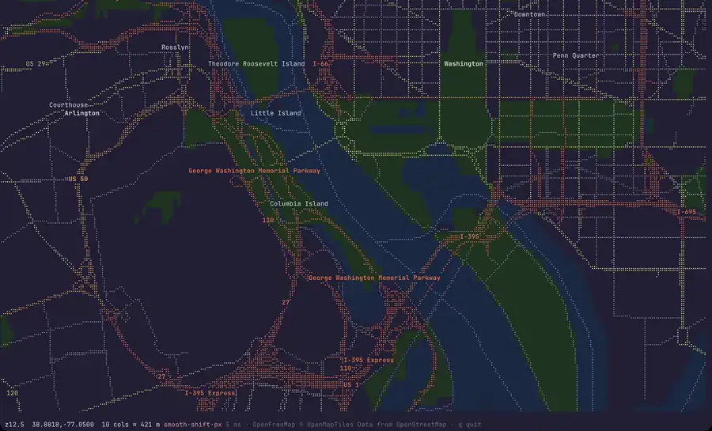

# mapterm

[](https://github.com/tlpinney/mapterm/actions/workflows/ci.yml)
[](https://crates.io/crates/mapterm)
[](https://docs.rs/mapterm)
[](Cargo.toml)
[](LICENSE)
[](https://mapterm.com)

A map in your terminal, with the pan, zoom and styling of a web map, that also works
over SSH.

Get it with `cargo install mapterm` ([other ways](#install)).



<details>
<summary>Watch the full 45s video</summary>

https://github.com/user-attachments/assets/8bf59b7f-3156-4820-aeeb-2b138fc5bc2b

</details>

- **Any vector tiles:** OpenFreeMap out of the box (no key), PMTiles files locally or over
  HTTP, MBTiles files, XYZ URLs and TileJSON, drawn in braille with cell-color fills and labels that
  don't collide.
- **MapLibre styles:** liberty, positron and the other OpenFreeMap styles, or your own,
  with expressions, filters, fonts and point icons.
- **Imagery:** satellite and aerial layers (OSM, Esri, USGS, NASA GIBS, Microsoft Planetary
  Computer's NAIP and Sentinel-2, and keyed
  providers such as Vantor, Planet and Mapbox) as real images in kitty-graphics terminals, or as
  cell colors anywhere else.
- **Your data:** GeoJSON, CSV, GPX, KML, FlatGeobuf, Shapefiles and GeoParquet, from a file or a URL, drawn over
  the map, with clustering for large point sets.
- **Live layers:** aircraft from free ADS-B feeds and ships from AIS, gliding between
  reports with trails; satellites placed from their orbits; and your own location.
- **Search and inspect:** find a place and fly there; point at anything to see its
  features and properties, and copy them as JSON.
- **Scriptable:** `--snapshot` prints a frame as text, ANSI or HTML, and `--pick` prints
  the features at a spot as JSON.

The same code is a library: a [ratatui](https://ratatui.rs) widget with a MapLibre GL
style API (sources, style layers, expressions, events and feature state, feature
queries) that you can drop into your own terminal apps.

Docs, a tour and the full guide: [mapterm.com](https://mapterm.com)

## Install

With Cargo (Rust 1.95 or newer, from [rustup.rs](https://rustup.rs)):

```sh
cargo install mapterm
```

On Linux (x86-64) you can also download a signed binary from
[Releases](https://github.com/tlpinney/mapterm/releases); the release notes show how to
verify it. To use the library in your own app: `cargo add mapterm`.

## Try it

```sh
mapterm                                                # OpenFreeMap planet, no key needed
mapterm --at 38.8895,-77.0353 -z 13                    # start somewhere (lat,lon) at zoom 13
mapterm --at here                                      # start where you are
mapterm --adsb --at 38.85,-77.04 -z 10                 # live aircraft over DC
mapterm --ais --at 38.98,-76.45 -z 10                  # live ships on the Chesapeake
mapterm --sats --at here -z 3                          # satellites, and when they pass over you
mapterm https://build.protomaps.com/20261031.pmtiles   # Protomaps planet over HTTP range requests
mapterm dc.pmtiles --at 38.8899,-77.0091 -z 13          # a local PMTiles file, offline
mapterm city.mbtiles                                   # or an MBTiles file
mapterm --style liberty                                # any MapLibre style: liberty, positron,
mapterm --style ./my-style.json                        #   bright, dark, fiord, a URL or a file
mapterm --style mapbox://styles/mapbox/streets-v12 --mapbox-token-cmd 'pass show mapbox-token'  # Mapbox
mapterm --snapshot 120x40 --at 38.8895,-77.0353         # print one frame as text and exit
mapterm --snapshot 120x40 --format html > map.html       #   ... or as colored ANSI text or HTML
mapterm --snapshot 100x30 --format describe              #   ... or in words (for a language model)
mapterm --snapshot 100x30 --format png > view.png        #   ... or as an image (no labels)
mapterm --raster esri --snapshot 100x30 --format png > sat.png  # ... over satellite imagery
```

More examples and every option: `mapterm --help`, and the guides below.

## Controls

They follow the MapLibre GL / Mapbox GL defaults:

- **Scroll / two-finger swipe up and down:** zoom toward the cursor
- **Drag:** pan, and a fling keeps gliding (inertia)
- **Double-click:** zoom in; **shift+double-click:** zoom out
- **Shift+drag:** box zoom
- **Arrows** (or `hjkl`) pan, **`+`/`-`** zoom to the next level, both eased
- **`/`** searches for a place: type, press Enter, and the map flies there
  (MapLibre's flyTo curve). Several matches open a list (↑/↓, Enter or click);
  Esc clears the marker. Searches go to [Photon](https://photon.komoot.io), an
  OpenStreetMap geocoder, only when you press Enter; `MAPTERM_GEOCODER=nominatim`
  or the URL of your own Photon or Nominatim server switches.
- **`m`** switches the map style: the built-in one, then OpenFreeMap's liberty,
  positron, bright, dark and fiord (a `--style` you started with comes first).
  Imagery stays underneath and your GeoJSON layers on top.
- **`g`** goes to where you are and marks it with a blue dot (see
  [Your location](docs/live-layers.md#your-location)).
- **`c`** copies the coordinates under the pointer (or the map center) as
  `lat, lon` to the clipboard (OSC 52).
- Terminal extras: sideways swipes pan; `i` inspect, `v` vector overlay, `n` labels, `t` light/dark theme (built-in style), `q` quit

## More

- [Snapshots and scripting](docs/snapshots.md): `--snapshot`, `--format describe` and
  `png` for language models, `--pick`
- [Styles and rendering](docs/styles.md): the built-in and MapLibre styles, local
  tiles, what mapterm reads
- [Your data and inspecting the map](docs/data-layers.md): GeoJSON, CSV, GPX, KML,
  FlatGeobuf, Shapefiles, GeoParquet, and `i` inspect
- [Imagery](docs/imagery.md): satellite and aerial layers, keys and limits
- [Live layers](docs/live-layers.md): your location, aircraft (`--adsb`), ships
  (`--ais`), satellites (`--sats`)
- [Use it in your own app](docs/library.md): the library API
- [Experimental](docs/experimental.md): pixel mode and smooth scrolling

## Use it in your own app

mapterm is also a library that works like MapLibre GL: a `Map` holds named
sources and an ordered list of style layers that say how to draw them.

```rust
let mut map = Map::from_style("liberty").await?;          // any MapLibre style
map.add_source("sites", MapSource::geojson(&sites)?)?;
map.add_layer(StyleLayer::fill("sites", "sites").color("#204060"))?;
map.load_tiles(&ctl.cam, area).await?;
frame.render_widget(map.view(&ctl.cam), area);
```

More in [docs/library.md](docs/library.md) and on [docs.rs](https://docs.rs/mapterm).

## License

MIT. Map data © OpenStreetMap contributors.

Release archives include `THIRD_PARTY_LICENSES.txt`, the license terms and copyright
notices of the crates built into the binary. To make it from a checkout:
`cargo about generate about.hbs -o THIRD_PARTY_LICENSES.txt` (cargo-about 0.9.2).

Labels drawn as images (satellite names) use the bundled
[JetBrains Mono](https://github.com/JetBrains/JetBrainsMono) font, © The JetBrains Mono
Project Authors, under the SIL Open Font License 1.1 (`fonts/OFL.txt`, and
`JetBrainsMono-OFL.txt` in release archives); `MAPTERM_FONT` picks another.
